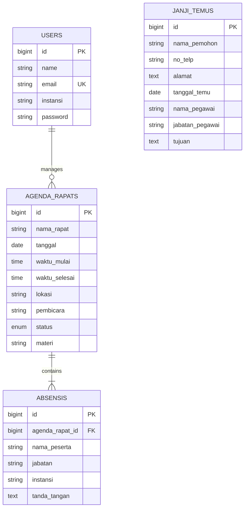

<p align="center">
  
</p>

<h1 align="center">DISTANHORTI Guest & Meeting Management System</h1>

<p align="center">
  <b>A Digital Guestbook, Meeting Scheduling, and QR Code Attendance Management System</b><br>
  Built for the Department of Food Crops and Horticulture (DISTANHORTI)
</p>

<p align="center">
  
  
  
  
  
  
</p>

---

## 📌 Project Overview

**DISTANHORTI Web Application** is an integrated public sector solution engineered to modernize guest management and internal meeting administration.

Replacing traditional manual paper-based logs that often suffer from data inconsistency and loss, this platform delivers an end-to-end digital workflow featuring **Online Appointment Booking**, **Dynamic Meeting Scheduling**, **Automated QR Code Attendance**, and a **Touchscreen Digital Signature Canvas**.

---

## ✨ Key Features

### 🌐 Public & Guest Portal
- **Interactive Landing & Agency Profile**: Comprehensive overview of agency responsibilities, announcements, and initiatives.
- **Meeting Schedule Viewer**: Real-time display of ongoing and upcoming public or departmental meetings.
- **Paperless Attendance Recording**:
  - Instant meeting check-in via dynamic **QR Code scanning**.
  - Interactive **HTML5 Canvas Digital Signature** for direct presence verification.
- **Online Appointment Request (Digital Guestbook)**:
  - Visitors can submit meeting proposals to specific officers or divisions.
  - Transparent tracking of submitted appointments.

### 🔐 Administrative Back Office
- **Role-Based Authentication**: Secure login session guarded by specialized authentication middleware.
- **Executive Dashboard**: Real-time analytical summary of guest visits, attendee metrics, and scheduled events.
- **Meeting Management (CRUD)**:
  - Create and configure meetings (date, time window, venue, speakers, agenda attachments).
  - Automatically generates and downloads unique printable **QR Code badges** for projection or check-in desks.
- **Attendance Verification & Export**:
  - Review attendee lists along with captured electronic signatures and timestamps.
- **Appointment Processing**:
  - Review, manage, and audit guest appointment requests.
- **User & Access Control**: Administrator profile management and system credential controls.

---

## 🛠️ Technology Stack

- **Backend**: [Laravel 12](https://laravel.com/) (PHP 8.2+)
- **Database**: MySQL / MariaDB (managed via Eloquent ORM & Migrations)
- **Frontend & UI**:
  - [Tailwind CSS v4](https://tailwindcss.com/)
  - [Flowbite UI](https://flowbite.com/)
  - [Alpine.js](https://alpinejs.dev/)
- **Bundler**: [Vite](https://vitejs.dev/) & Laravel Vite Plugin
- **Key Packages**:
  - `endroid/qr-code`: High-performance QR Code generation.
  - HTML5 Signature Pad API: Smooth vector-based signature capture on desktop and mobile browsers.

---

## 🗄️ Database Architecture

Below is the entity-relationship model implemented in the system:



---

## 🚀 Installation & Local Setup Guide

Follow these steps to run the project on your local machine:

### 1. Prerequisites
Ensure the following tools are installed:
- **PHP >= 8.2** (with `pdo_mysql`, `mbstring`, `gd` extensions enabled)
- **Composer** (PHP dependency manager)
- **Node.js** (v18+ recommended) & **NPM**
- **MySQL Server** (via Laragon, XAMPP, or native service)

---

### 2. Clone the Repository
```bash
git clone https://github.com/YOUR-USERNAME/distanhorti.git
cd distanhorti
```

---

### 3. Install Dependencies
```bash
# Install PHP packages
composer install

# Install JavaScript and CSS packages
npm install
```

---

### 4. Configure Environment
Create your local environment file and generate the application encryption key:

```bash
# Duplicate the example environment file
cp .env.example .env

# Generate application key
php artisan key:generate
```

Open `.env` and configure your database parameters:
```env
DB_CONNECTION=mysql
DB_HOST=127.0.0.1
DB_PORT=3306
DB_DATABASE=distanhorti
DB_USERNAME=root
DB_PASSWORD=
```
*(Make sure an empty database named `distanhorti` has been created in your MySQL instance)*.

---

### 5. Run Migrations & Seed Default Data
Build database tables and populate the default administrator account:
```bash
php artisan migrate --seed
```

---

### 6. Build Frontend Assets
Choose one of the following based on your current task:

- **For Development (Hot Module Replacement / live preview)**:
  ```bash
  npm run dev
  ```
- **For Production (Pre-compiled optimized assets)**:
  ```bash
  npm run build
  ```

---

### 7. Launch Local Server
In a new terminal window, start the Laravel server:
```bash
php artisan serve
```

Access the system in your web browser:
- **Public Portal**: [http://127.0.0.1:8000](http://127.0.0.1:8000)
- **Admin Login**: [http://127.0.0.1:8000/login](http://127.0.0.1:8000/login)

---

## 🔑 Default Demo Credentials

Once database seeding completes, use the following pre-configured credentials to access the admin back office:

| Property | Default Value |
| :--- | :--- |
| **Login URL** | `http://127.0.0.1:8000/login` |
| **Email** | `admin@gmail.com` |
| **Password** | `admin123` |
| **Department / Division** | HUMAS |

> **Security Notice:** Please change default credentials immediately when deploying to any internet-facing environment.

---

## 📁 Project Directory Structure

```text
distanhorti/
├── app/
│   ├── Http/Controllers/       # Request handlers (Meeting, Attendance, Appointments, Auth)
│   └── Models/                 # Eloquent entities (AgendaRapat, Absensi, JanjiTemu, User)
├── database/
│   ├── migrations/             # Schema definitions for all tables
│   └── seeders/                # Initial data generators (UserSeeder, DatabaseSeeder)
├── public/
│   ├── build/                  # Vite production bundle output & manifest
│   └── images/                 # Static graphical assets & agency logos
├── resources/
│   ├── css/                    # Tailwind CSS v4 source stylesheets
│   ├── js/                     # Client-side scripts and Flowbite integration
│   └── views/                  # Blade template hierarchy
│       ├── admin/              # Administrator dashboard & management views
│       └── user/               # Public guest & attendee views
├── routes/
│   └── web.php                 # Application route endpoints & middleware groups
├── .env.example                # Standard environment configuration template
├── composer.json               # Backend dependency definitions
├── package.json                # Frontend asset tooling configurations
└── vite.config.js              # Vite asset compilation setup
```

---

## 💡 Troubleshooting

<details>
<summary><b>1. ViteManifestNotFoundException</b></summary>
<br>

This happens if the frontend bundle has not been generated yet. Run:
```bash
npm run build
```
Or keep the Vite development server active in a separate terminal:
```bash
npm run dev
```
</details>

<details>
<summary><b>2. Unknown database 'distanhorti'</b></summary>
<br>

Create the database in MySQL first (e.g. via phpMyAdmin or `CREATE DATABASE distanhorti;`), then rerun:
```bash
php artisan migrate --seed
```
</details>

<details>
<summary><b>3. Broken Storage Symlinks / Uploaded Assets</b></summary>
<br>

Link the storage directory to the public directory:
```bash
php artisan storage:link
```
</details>

---

## 📄 License

This software is released under the [MIT License](LICENSE).
